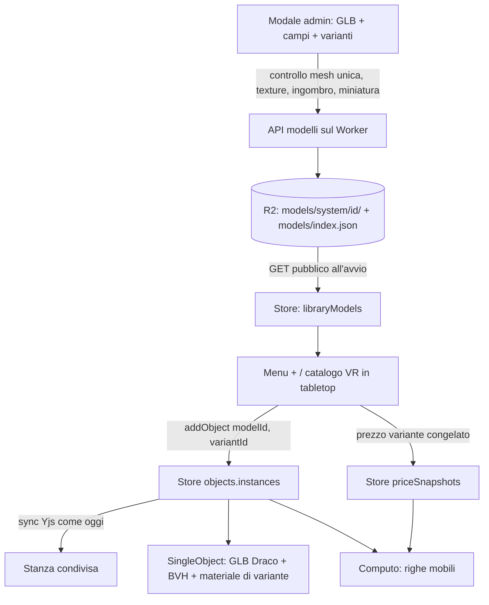
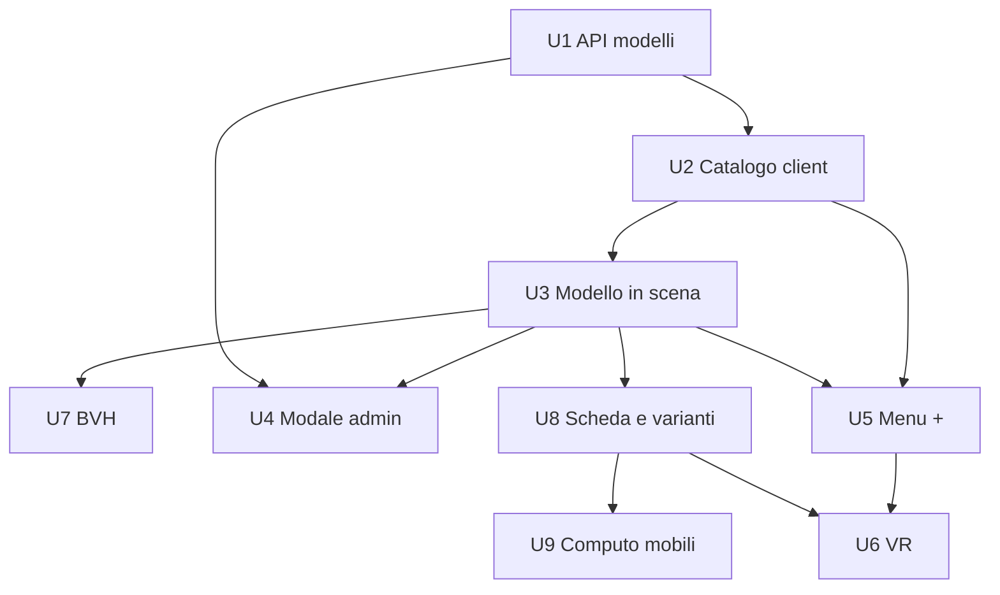

# Catalogo modelli 3D - Plan

## Goal Capsule

- **Obiettivo:** chi arreda sceglie mobili reali da un catalogo (prodotti con produttore, codice, varianti e prezzo), li vede nella stanza su desktop, mobile e VR, e li ritrova nel computo.
- **Mezzo:** catalogo modelli costruito sullo schema della libreria materiali (API su R2, scheda nel client, prezzi congelati), GLB a mesh unica con Draco (KTD1, KTD2).
- **Autorità di prodotto:** Flavio (owner). Il Product Contract vince sul comportamento; i KTD vincono sul meccanismo. Questo piano copre solo il catalogo con la libreria campione dell'admin; account, librerie personali, piani e quote non sono scope attivo.
- **Stop:** fermarsi e chiedere se un'unità richiede di cambiare un R, se un GLB reale della libreria campione non rispetta il contratto di R18, o se le prestazioni su Quest restano insufficienti dopo U7.
- **Profilo di esecuzione:** piccoli passi verificati uno per uno; Flavio prova con `npm run dev` e fa lui commit e push.
- **Blocchi aperti:** nessuno.

---

## Product Contract

**Preservazione:** changed: R14 precisato e aggiunto R18 (formato in ingresso fissato da Flavio: GLB a mesh unica con almeno una texture, texture delle varianti aggiungibili dopo); R8 e R12 precisati dopo la revisione del documento (scheda e catalogo dicono se un mobile è fisso; il segnale è il solo contorno). Aggiunti agli esclusi i modelli animati.

### Summary

Un catalogo di mobili 3D (GLB compressi con Draco) popolato oggi dall'admin come libreria campione. Ogni modello è un prodotto con varianti di finitura (ognuna col suo codice e prezzo), un flag spostabile/fisso che vale in VR in prima persona, e una riga nel computo. Il menu "+" diventa un catalogo a due livelli, prima le categorie poi i modelli, con ricerca e filtro per produttore; le forme base sono una delle categorie.

### Problem Frame

Oggi il menu "+" aggiunge solo forme primitive (`src/store/slices/objectsSlice.js`, `objectsList`) e la tab "Furnitures" è disattivata (`src/components/ui/objects-menu/ObjectsMenu.jsx`). L'app arreda solo le superfici (materiali di muri e pavimenti, porte e finestre): mancano i mobili, che sono il cuore di un progetto di interior design e di un preventivo. Il computo esiste già per i materiali con prezzi congelati, ma non conosce prodotti a pezzo.

### Key Decisions

- **Varianti = tinta e/o texture sostitutiva per ogni materiale del modello.** Un colore semplice non occupa storage. Governs R5, R6. (session-settled: user-directed — chosen over solo tinta (niente legni diversi) e un GLB per variante (storage moltiplicato): copre i casi reali al minimo costo)
- **In scena si usano solo le varianti di catalogo.** Il computo resta veritiero. Governs R7. (session-settled: user-directed — chosen over colore libero o materiali della libreria sul mobile: la personalizzazione creativa arriverà dopo, fuori dal computo)
- **Codice e prezzo per variante.** Governs R8, R16. (session-settled: user-approved — chosen over prezzo unico per modello: impreciso quando i colori costano diversamente)
- **Flag spostabile/fisso nella scheda, proposto in automatico.** Governs R9. (session-settled: user-approved — chosen over sola categoria o sola dimensione: servono eccezioni)
- **In VR prima persona non si aggiungono mobili e non si spostano i fissi.** Spostare una cucina o un armadio di 4 m non è realistico e in prima persona manca la visione d'insieme. Governs R11, R12, R13. (session-settled: user-directed — chosen over inserimento anche in prima persona: si aggiunge solo in tabletop)
- **Catalogo per tipo, sottotipi a chip, produttore come filtro.** Governs R1–R4. (session-settled: user-directed — chosen over per ambiente e per produttore come primo livello)
- **Menu "+" a due livelli (categorie, poi modelli).** Governs R1, R2. (session-settled: user-directed — chosen over pannello a tab come Materiali e lista tipi a sinistra, dopo gli schizzi A/B/C)
- **I mobili entrano nel computo già nella prima versione.** Governs R15–R17. (session-settled: user-approved — chosen over computo in un secondo passo)
- **GLB in ingresso a mesh unica con almeno una texture.** I file arrivano già preparati; le texture delle varianti si aggiungono anche dopo. Governs R14, R18. (session-settled: user-directed — chosen over unire più mesh al caricamento: Flavio fornisce i modelli già a mesh unica)

### Requirements

**Menu "+" e navigazione del catalogo**

- R1. Il menu "+" si apre sulla griglia delle categorie per tipo: Sedute, Tavoli, Contenitori, Letti, Cucine, Bagno, Luci, Decorazioni, Esterni, più "Forme base" (le primitive di oggi).
- R2. Scelta una categoria, il menu mostra i modelli in griglia con miniature, i chip dei sottotipi presenti e un "indietro" alle categorie.
- R3. Una ricerca per nome o codice prodotto cerca in tutto il catalogo.
- R4. Il filtro per produttore restringe categorie e modelli: su desktop la lista dei produttori sta a sinistra della griglia; su mobile e VR un tasto passa alla schermata dei produttori e poi torna.

**Scheda del modello e varianti**

- R5. Ogni modello ha una o più varianti; una variante cambia, per ciascun materiale del modello, una tinta e/o una texture sostitutiva.
- R6. Una variante si sceglie all'inserimento e si cambia dopo sul mobile selezionato, su desktop, mobile e VR (anche in prima persona).
- R7. Chi arreda sceglie solo tra le varianti di catalogo; non esistono colori o materiali liberi sui mobili in questa versione.
- R8. La scheda prodotto mostra produttore, nome, misure reali, se è fisso, variante, codice e prezzo della variante (netto + IVA), e il link al produttore se presente; anche il catalogo segna i modelli fissi.

**Spostabile o fisso**

- R9. Ogni modello è "spostabile" o "fisso"; al caricamento il valore viene proposto dalla categoria e dalle misure reali, e chi carica può cambiarlo.
- R10. Su desktop, mobile e in tabletop ogni mobile si sposta e ruota come oggi, fisso o no.
- R11. In VR prima persona qualsiasi mobile si seleziona, mostra la scheda, cambia variante e si elimina; solo gli spostabili si prendono, spostano e ruotano.
- R12. In VR prima persona un tentativo di prendere un mobile fisso fa lampeggiare il suo contorno e non lo muove.
- R13. In VR il catalogo per aggiungere mobili è disponibile solo in tabletop.

**Caricamento (admin, libreria campione)**

- R14. L'admin carica un modello GLB compresso con Draco con nome, produttore, categoria, sottotipo, varianti (con codice e prezzo), flag spostabile/fisso e link facoltativo; la miniatura è generata dall'app. Si può modificare la scheda (anche aggiungendo texture alle varianti) ed eliminare il modello, come per i materiali.
- R18. Il caricamento accetta solo un GLB con una sola mesh e almeno una texture; altrimenti rifiuta il file con un messaggio che dice cosa manca.

**Computo**

- R15. Ogni mobile in scena con prezzo produce una riga nel computo per prodotto + variante, con quantità, prezzo netto, IVA e totale.
- R16. Il prezzo della variante si congela al primo inserimento di quella variante, come per i materiali; cambiando variante il computo usa il prezzo congelato della nuova.
- R17. Le forme base non entrano mai nel computo.

### Acceptance Examples

- AE1. **Covers R11, R12.** Given un armadio fisso e una sedia spostabile nella stanza, when in VR prima persona provo a prenderli, then la sedia si sposta e l'armadio resta fermo con il contorno che lampeggia; selezionando l'armadio posso vederne la scheda, cambiarne la variante o eliminarlo.
- AE2. **Covers R10, R13.** Given lo stesso armadio, when passo in tabletop, then posso spostarlo e ruotarlo e posso aggiungere nuovi mobili dal catalogo; tornato in prima persona il catalogo per aggiungere non c'è.
- AE3. **Covers R15, R16.** Given due sedie dello stesso modello in variante "rovere" a 120 € e una in "noce" a 150 €, when apro il computo, then vedo due righe: rovere × 2 e noce × 1. Se poi il listino del rovere sale, le righe restano ai prezzi congelati.
- AE4. **Covers R6, R16.** Given una sedia in "rovere", when la cambio in "noce", then la sua riga passa a noce, con il prezzo congelato di noce (congelato ora se è il primo inserimento di noce).
- AE5. **Covers R4.** Given su telefono la categoria Sedute aperta, when tocco il tasto produttori e scelgo un marchio, then torno alle Sedute filtrate per quel marchio.
- AE6. **Covers R18.** Given un GLB con tre mesh separate, when l'admin lo carica, then il modale lo rifiuta dicendo che serve una sola mesh; lo stesso per un GLB senza texture.

### Scope Boundaries

- Account, librerie personali per utente, piani free/pro, limiti di upload e quote di storage: area separata (sotto).
- Personalizzazione creativa (colore libero o materiali della libreria sul mobile), esclusa dal computo: compito laterale per dopo.
- Modelli animati o con parti mobili (ante che si aprono, TV che si accendono): da studiare in futuro (formato, preparazione, caricamento).
- Modellatore integrato nell'app.
- Formati diversi da GLB+Draco (FBX, OBJ, SketchUp, conversioni) e unione di più mesh al caricamento.
- Ottimizzazione automatica dei file al caricamento: i GLB arrivano già ottimizzati dall'admin.

#### Deferred to Follow-Up Work

- LOD (versioni semplificate a distanza) e istanziazione di mobili ripetuti: solo se le misure su Quest lo chiederanno.

<!-- ce-section: work-relationships -->
### How This Work Fits Together

Questo piano possiede il catalogo modelli con la libreria campione dell'admin. La suddivisione sotto è la comprensione attuale, non una roadmap impegnata.

- Account e spazio (piani free/pro, quote di upload e storage, costi del servizio)
  - Depends on: un sistema di account che oggi non esiste (solo il token admin).
  - Shares: la scheda del modello (campo `owner`) e il caricamento di questo piano; le librerie personali sono lo stesso catalogo con un proprietario diverso.
  - Still to decide: limiti per file e totali per piano, in proporzione al costo dello storage.
- Personalizzazione creativa dei mobili
  - Depends on: le varianti per materiale di questo piano.
  - Shares: la regola che il computo conta solo prodotti reali.
- Modelli animati
  - Depends on: un formato con parti nominate e stati (come le porte parametriche, `room/doorModel.js`).
- Modellatore integrato
  - Enables: modelli creati dall'utente che entrano nello stesso catalogo e vanno in scena.

### Dependencies / Assumptions

- I GLB della libreria campione arrivano già ottimizzati per il Quest (geometria Draco, texture compresse e ridotte, una mesh, scala in metri); Flavio li prepara con aiuto.
- La soglia di misura per la proposta del flag fisso si tara sui primi modelli reali (U4).

### Sources / Research

- `src/components/ui/objects-menu/ObjectsMenu.jsx`: menu "+" attuale, solo primitive, tab "Furnitures" disattivata.
- `src/store/slices/objectsSlice.js`: `objectsList` delle primitive e `addObject`.
- `src/materials/library.js`, `src/materials/materialsApi.js`, `server/src/materials.js`: modello per catalogo su R2, caricamento admin e modale di modifica.
- `src/materials/grouping.js`: tab per categoria + chip per tipo, lista dei tipi solo nel client.
- `src/materials/billOfQuantities.js` (`priceSnapshot`), `src/store/slices/surfacesSlice.js` (`withPrice`): computo e prezzi congelati da estendere ai prodotti a pezzo.

---

## Planning Contract

### Key Technical Decisions

- KTD1. **Stesso bucket R2 dei materiali, prefisso `models/system/<id>/`, scheda con `owner: 'system'`.** Nessuna nuova infrastruttura; il prefisso per proprietario rende quote e cancellazioni future un'operazione su prefisso. Elenco in `models/index.json` come `materials/index.json` (stesso limite noto: un solo scrittore).
- KTD2. **Contratto del GLB controllato nel browser al caricamento.** Il modale apre il file con lo stesso loader della scena, conta le mesh, legge i nomi dei materiali e le texture, misura l'ingombro. Il server controlla tipo (intestazione `glTF`), peso (massimo 30 MB per il GLB, 4 MB per texture, come i materiali) e i campi della scheda elencati in U1. Governs R14, R18.
- KTD3. **Decoder Draco servito dall'app** da `public/draco/` (copiato dai file del decoder inclusi in three). Funziona in locale e offline, nessuna dipendenza da gstatic. (session-settled: user-approved — chosen over il decoder predefinito da gstatic: dipende da un servizio esterno)
- KTD4. **Una variante = copia del materiale del GLB con tinta moltiplicata e/o mappa colore sostituita.** I materiali per variante sono in cache per modello + variante e condivisi tra tutte le copie in scena (stessa regola dei materiali condivisi di `SurfaceMesh.jsx`). Le texture delle varianti passano da `imageToWebp.js` come quelle dei materiali e si caricano come le mappe del GLB (`flipY` false, spazio colore sRGB), altrimenti apparirebbero capovolte. Instanzia R5.
- KTD11. **Le parti della mesh glTF diventano una geometria con gruppi.** In glTF una mesh con N materiali ha N primitive, che il loader di three restituisce come N mesh in un gruppo. Al caricamento si applica la trasformazione del nodo, si fondono le parti in una geometria con un gruppo per materiale (`mergeGeometries` con gruppi) e un array di materiali nello stesso ordine, chiamati per nome. Così ogni modello resta una sola `THREE.Mesh` per note, righello, presa e contorno.
- KTD12. **Caricamento senza Suspense.** Il GLB si carica in un effetto con cache per modello, come la texture di `UnderlayPlane.jsx`; la stessa `<mesh>` resta montata e passa dalla scatola segnaposto al modello cambiando solo geometria e materiale (i listener di presa restano validi).
- KTD13. **I mobili del catalogo hanno scala 1 e il gizmo non li scala.** Misure reali e computo restano veri. (session-settled: user-approved — chosen over scalabili come le primitive: falserebbero misure e prezzo a pezzo)
- KTD5. **BVH con `three-mesh-bvh` sulla geometria dei modelli, calcolato una volta al caricamento.** Raycast e `meshSpherecast` usano l'indice invece di provare tutti i triangoli. (session-settled: user-approved — chosen over rimandarlo: con modelli reali presa, tocco e impronta in VR rallentano il Quest)
- KTD6. **L'istanza in scena aggiunge `modelId` e `variantId` accanto a `type`.** Le primitive restano invariate. L'istanza intera continua a sincronizzarsi come oggi (`bindInstances` in `roomSync.js`) ed entra nell'undo come gli altri oggetti.
- KTD7. **Prezzi dei mobili nella stessa mappa `priceSnapshots` (Y.Map "prices") con chiave `model:<modelId>:<variantId>`.** Si congelano in `addObject` e nel cambio di variante, con la stessa logica di `withPrice`. Instanzia R16.
- KTD8. **Miniatura generata nel browser al caricamento**: render del modello su un canvas fuori schermo, 256 px, WebP. Nessun lavoro lato server.
- KTD9. **Il blocco dei fissi vive nel filtro di presa di `SingleObject.jsx`**, che legge modalità XR e vista (`life` / `tabletop`). Desktop, mobile e tabletop non cambiano. Instanzia R10–R12.
- KTD10. **Categorie, sottotipi e ricerca nel client** (`src/models/grouping.js`, come `src/materials/grouping.js`); il server controlla solo la forma degli id. Produttori = valori distinti del campo `brand` delle schede.

### High-Level Technical Design

Flusso dei dati, dal caricamento al computo:

Cosa si può fare con un mobile per modalità (R10–R13):

| Modalità | Aggiungere | Selezionare / scheda / variante / eliminare | Spostare spostabile | Spostare fisso |
|---|---|---|---|---|
| Desktop e mobile | sì | sì | sì | sì |
| VR tabletop | sì | sì | sì | sì |
| VR prima persona | no | sì | sì | no (segnale leggero) |

### Assumptions

- Un GLB in metri e con l'alto su +Y (convenzione glTF); il caricamento porta l'origine al centro della base.
- I nomi dei materiali dentro il GLB sono stabili: le varianti li usano come chiave.
- Le texture dentro il GLB sono JPEG, PNG o WebP; KTX2/Basis non è gestito (servirebbe il KTX2Loader con transcoder).

### Risks

- **Molti sistemi assumono una mesh per oggetto** (`meshRef`, note, righello, impronta, contorno). Il contratto a mesh unica (R18) più la fusione delle parti (KTD11) evita di toccarli; un GLB con più nodi mesh è rifiutato.
- **Prestazioni su Quest** con texture grandi: mitigato da texture già ridotte nei file e materiali condivisi (KTD4); da misurare con il pannello performance.
- **Outline di selezione** (`SelectionOutline.jsx`) su geometrie dense: verificare il costo su WebGPU e WebGL in U3.

---

## Implementation Units

### U1. API dei modelli sul Worker

**Goal:** catalogo dei modelli su R2 con lettura pubblica e scrittura solo admin.

**Requirements:** R14, R18 (lato server), KTD1, KTD2.

**Dependencies:** nessuna.

**Files:**
- `server/src/models.js` (nuovo)
- `server/src/index.js` (instradamento `/api/models` e `/files/models/...`)
- `server/api.check.mjs` (casi dei modelli)

**Approach:**
1. Copiare la struttura di `server/src/materials.js`: `GET /api/models`, `POST` multipart (GLB, miniatura, campi), `PATCH /api/models/:id` (campi e varianti), `POST /api/models/:id/textures` (aggiunge texture di variante, restituisce le chiavi), `DELETE /api/models/:id` (scheda e tutti i file del prefisso).
2. Scheda: `{ id, owner, name, brand, category, subtype, size, fixed, url, files: { glb, thumb }, variants: [{ id, name, code, price, vatRate, overrides }] , createdAt }`, con `overrides` = nome del materiale del GLB → `{ tint?, map? }` (chiave R2 della texture).
3. Validazione: GLB con intestazione `glTF` e al massimo 30 MB; texture WebP/JPEG/PNG al massimo 4 MB; nome, produttore (`brand`), categoria e sottotipo obbligatori; almeno una variante; prezzi e IVA come `readFields` dei materiali; `url` solo http/https.
4. File serviti da `/files/models/system/<id>/<file>` con cache immutabile di un anno.

**Patterns to follow:** `server/src/materials.js` (validazione, indice JSON, CORS, `isOwner`), `server/src/underlays.js`.

**Test scenarios:**
- POST valido da admin restituisce la scheda con `owner: 'system'` e compare in GET.
- POST senza token restituisce 401; PATCH e DELETE pure.
- POST con file che non è glTF, o GLB oltre 30 MB, restituisce 400 con messaggio.
- POST senza varianti, o con variante con prezzo negativo, restituisce 400.
- POST senza produttore o senza sottotipo restituisce 400.
- PATCH di nome, flag fisso e varianti aggiorna solo quei campi.
- POST di una texture di variante restituisce una chiave servita da `/files/models/...`.
- DELETE toglie la scheda dall'indice e i file dal prefisso; GET del file dopo dà 404.

**Verification:** `node server/api.check.mjs` passa con `wrangler dev` e `ADMIN_TOKEN=test`.

### U2. Catalogo nel client e raggruppamento

**Goal:** le schede dei modelli caricate all'avvio nello store e organizzate per categoria, sottotipo, produttore e ricerca.

**Requirements:** R1–R4 (dati), KTD10.

**Dependencies:** U1.

**Files:**
- `src/models/modelsApi.js` (nuovo, come `src/materials/materialsApi.js`)
- `src/models/catalog.js` (nuovo: `useModel(id)`, `useModelList()`)
- `src/models/grouping.js` + `src/models/grouping.check.mjs` (nuovi)
- `src/store/slices/` (campo `libraryModels`, nella slice dei materiali o in una nuova `modelsSlice.js`)
- `src/App.jsx` (carica l'elenco all'avvio, come `libraryMaterials`)

**Approach:**
1. `grouping.js`: elenco delle categorie (R1) con i loro sottotipi; "Forme base" come categoria speciale che elenca le primitive di `objectsList`; funzioni pure `categoriesWith(models, brand)`, `subtypesIn(models, category)`, `brandsOf(models)`, `searchModels(models, text, brand)` su nome e codici delle varianti, dentro il produttore attivo se c'è.
2. Sottotipo sconosciuto = "Altro", come `kindOf` dei materiali.
3. Un modello sconosciuto (eliminato o non ancora caricato) restituisce null: la scena mostra un segnaposto (U3).

**Patterns to follow:** `src/materials/grouping.js`, `src/materials/library.js`.

**Test scenarios:**
- `categoriesWith` mostra solo le categorie con almeno un modello, più "Forme base" sempre.
- Con un produttore scelto, categorie e modelli si restringono a quel produttore (covers AE5 lato dati).
- `searchModels` trova per nome senza badare a maiuscole e per codice di una variante.
- `searchModels` con un produttore attivo non restituisce modelli di altri produttori.
- Un sottotipo non in elenco finisce in "Altro".
- `brandsOf` restituisce produttori distinti in ordine alfabetico.

**Verification:** `node src/models/grouping.check.mjs` stampa ok; all'avvio lo store ha l'elenco del server.

### U3. Modello in scena (GLB, Draco, variante)

**Goal:** `SingleObject` disegna un modello del catalogo con la variante scelta, con tutte le interazioni di oggi.

**Requirements:** R5, R6 (resa), KTD3, KTD4, KTD6, KTD11, KTD12, KTD13.

**Dependencies:** U2.

**Files:**
- `public/draco/` (file del decoder copiati da three)
- `src/models/variants.js` + `src/models/variants.check.mjs` (nuovi: risoluzione pura variante → override per materiale)
- `src/models/loadModel.js` (nuovo: GLTFLoader + DRACOLoader con decoder in `/draco/`, cache per modello; trasformazione del nodo applicata, parti fuse in una geometria con gruppi, origine al centro della base)
- `src/models/useModelMesh.js` (nuovo: hook senza Suspense che restituisce geometria e materiali della variante in cache, o null mentre carica)
- `src/components/scene/level/SingleObject.jsx` (geometria e materiali dal modello quando `data.modelId`; niente scala dal gizmo per i modelli)
- `src/store/slices/objectsSlice.js` (`addObject` accetta un modello, una variante e la posizione)

**Approach:**
1. `loadModel(modelId)` carica il GLB una volta (KTD12) e prende l'unico nodo mesh: applica la sua matrice alla geometria, fonde le primitive in una geometria con gruppi e un array di materiali per nome (KTD11).
2. La geometria è centrata una volta per modello (base a y = 0, centro in x/z) e condivisa da tutte le copie.
3. Il materiale di variante è una copia del materiale del GLB con `color` moltiplicato dalla tinta e `map` sostituita se la variante ha una texture; cache per modello + variante (KTD4).
4. `SingleObject` passa geometria e array di materiali alla mesh esistente (`meshRef`, `userData.objectId`, `spherecast`): note, righello, impronta, contorno e drag restano invariati. Hover: la tinta emissiva va applicata senza modificare i materiali condivisi (es. un overlay o materiali clonati solo per hover/selezione).
5. Mentre il GLB carica, o se il modello non esiste, la stessa `<mesh>` mostra una scatola segnaposto delle misure della scheda.
6. Mobili del catalogo a scala 1, gizmo senza scala (KTD13). Inserimento: sul pavimento al centro della vista, dentro la stanza (`keepOverSurface`); in tabletop davanti all'utente sul plastico. Il nuovo mobile risulta selezionato.
7. Le primitive continuano dal percorso attuale (`renderGeometry`).

**Patterns to follow:** `level/room/SurfaceMesh.jsx` (materiali condivisi per id, mai distrutti da React), `src/materials/library.js` (preload).

**Test scenarios:**
- `variants.js`: una variante senza override lascia i materiali del GLB; con tinta su "tessuto" cambia solo quel materiale; con texture sostituisce la mappa solo dove indicato.
- `variants.js`: un `variantId` sconosciuto ripiega sulla prima variante.
- Manuale: inserire due copie della stessa variante usa un solo materiale (pannello performance: nessuna texture in più).
- Manuale: note, righello, drag con impronta e contorno di selezione funzionano su un modello come su un cubo.
- Manuale: un modello eliminato dal catalogo mostra la scatola segnaposto, non un errore.
- Manuale: un GLB con due materiali (es. legno e tessuto) si vede come una mesh sola; la variante cambia solo il tessuto.
- Manuale: una texture di variante asimmetrica (es. con una scritta) appare orientata come l'originale.
- Manuale: un GLB esportato con rotazione sul nodo appare dritto e con le misure giuste.
- Manuale: un mobile inserito appare al centro della vista sul pavimento, selezionato; il gizmo non offre la scala.

**Verification:** `node src/models/variants.check.mjs` stampa ok; un modello campione si vede e si manipola su WebGPU, WebGL e Quest.

### U7. Accelerazione dei raycast (BVH)

**Goal:** presa, tocco del dito, impronta, righello e note sui modelli veri costano poco anche su Quest.

**Requirements:** KTD5; abilita R10–R12 con modelli reali.

**Dependencies:** U3.

**Files:**
- `package.json` (dipendenza `three-mesh-bvh`)
- `src/models/useModelMesh.js` (calcolo dell'indice sulla geometria condivisa)
- `src/components/scene/controls/meshSpherecast.js` + `meshSpherecast.check.mjs` (usa l'indice quando c'è)

**Approach:**
1. Al caricamento del modello, calcolare l'indice BVH una volta sulla geometria condivisa.
2. Il raycast delle mesh dei modelli usa l'indice (raycast accelerato della libreria).
3. `meshSpherecast` usa la ricerca per vicinanza dell'indice invece del ciclo su tutti i triangoli; senza indice (primitive) resta il ciclo attuale.

**Execution note:** spiegare a Flavio, passo per passo e con dettaglio, cosa fa ogni passaggio (cos'è l'indice, quando si calcola, come il raggio scarta le scatole, cosa cambia in `meshSpherecast`) mentre lo si implementa; misurare prima e dopo con il pannello performance su Quest.

**Patterns to follow:** commento di testa di `meshSpherecast.js`, che già prevede "per i GLB servirà un BVH".

**Test scenarios:**
- `meshSpherecast.check.mjs`: con indice, stessa distanza del metodo attuale su sfera e cilindro (risultato identico).
- `meshSpherecast.check.mjs`: punto dentro il solido restituisce distanza 0 anche con indice.
- Manuale su Quest: con 5 mobili da 100k triangoli, drag con impronta e tocco del dito restano fluidi (fps dal pannello performance, prima e dopo).

**Verification:** check ok; misura su Quest annotata in AGENTS.md.

### U4. Modale di caricamento e modifica (admin)

**Goal:** l'admin carica, modifica ed elimina i modelli della libreria campione.

**Requirements:** R9, R14, R18, AE6, KTD2, KTD8.

**Dependencies:** U1, U3.

**Files:**
- `src/components/ui/models-panel/ModelCreateModal.jsx` + css (nuovi)
- `src/models/inspectGlb.js` (nuovo: apre il GLB, conta mesh, legge nomi dei materiali, texture e ingombro)
- `src/models/fixedProposal.js` + `fixedProposal.check.mjs` (nuovi)
- `src/models/thumbnail.js` (nuovo: miniatura fuori schermo)

**Approach:**
1. Scelto il file, `inspectGlb` lo apre con lo stesso loader di U3: conta i nodi mesh del glTF (non le `THREE.Mesh`, una per materiale) e le texture; più di un nodo mesh o nessuna texture → errore con messaggio (R18). L'ingombro si misura dopo la trasformazione del nodo.
2. Dai nomi dei materiali nasce l'editor delle varianti: per ogni variante nome, codice, prezzo, IVA e, per materiale, tinta e texture facoltativa.
3. `fixedProposal(category, size)` propone il flag; l'admin lo può cambiare.
4. Miniatura generata e caricata insieme al GLB.
5. Modifica (✎) dalla griglia del catalogo: campi, varianti, aggiunta di texture (endpoint texture di U1). Elimina con seconda pressione di conferma, come i materiali.
6. Stati del modale: salvataggio disattivato finché mancano i campi obbligatori (nome, produttore, categoria, sottotipo, una variante), indicatore di avanzamento durante l'invio, e se una texture fallisce dopo il GLB la scheda resta salvata e la texture si riprova dalla modifica.

**Patterns to follow:** `src/components/ui/materials-panel/MaterialCreateModal.jsx`, `src/materials/imageToWebp.js`.

**Test scenarios:**
- `fixedProposal`: categoria Cucine → fisso; sedia 0,5 m → spostabile; contenitore con un lato > 1,5 m → fisso.
- Covers AE6. Manuale: GLB con tre mesh rifiutato con "serve una sola mesh"; GLB senza texture rifiutato.
- Manuale: un GLB valido si carica con due varianti, compare nel catalogo con la miniatura.
- Manuale: aggiungere una texture a una variante esistente cambia la resa in scena.
- Manuale: errore del server (es. file troppo grande) mostrato nel modale senza perdere i campi.

**Verification:** check ok; ciclo completo caricamento → modifica → eliminazione su `npm run dev` con `wrangler dev`.

### U5. Menu "+" a due livelli

**Goal:** il nuovo catalogo sostituisce `ObjectsMenu` su desktop e mobile.

**Requirements:** R1–R4, R17 (le forme base restano inseribili), AE5.

**Dependencies:** U2, U3.

**Files:**
- `src/components/ui/catalog-menu/CatalogMenu.jsx` + css (nuovi, sostituiscono `objects-menu/`)
- `src/components/ui/RightToolBar.jsx` (apre il nuovo menu)

**Approach:**
1. Livello 1: griglia delle categorie (`categoriesWith`), ricerca in alto.
2. Livello 2: chip dei sottotipi, griglia dei modelli con miniatura, "indietro".
3. Produttori: su desktop lista a sinistra sempre visibile; su telefono (≤ 767 px) tasto che passa alla schermata dei produttori e torna.
4. Clic su un modello = mostra i pallini delle sue varianti (prima variante preselezionata); la conferma inserisce quella scelta con `addObject` (posizione e selezione per U3) e chiude il menu.
5. Ricerca con testo = griglia dei risultati da tutto il catalogo, dentro il produttore attivo; "indietro" dai risultati torna alle categorie; il filtro produttore resta visibile (chip con ×) finché non si toglie.
6. Stati: miniature segnaposto mentre il catalogo carica; server irraggiungibile = messaggio con "Riprova" e restano le Forme base; ricerca senza risultati e categoria/produttore senza modelli = messaggio con tasto per togliere filtro o testo.
7. I modelli fissi hanno un segno sulla miniatura (R8). Ogni miniatura ha il nome visibile e un'etichetta accessibile; griglia e chip si raggiungono da tastiera; i bersagli touch hanno la misura minima delle altre barre.
8. Il bottone ✎ / "+" admin di U4 vive in questo menu.

**Patterns to follow:** `src/components/ui/materials-panel/MaterialsPanel.jsx` (pannello, `openPanel`, card su mobile), `ui/usePanelInViewport.js`.

**Test scenarios:**
- Covers AE5. Manuale su telefono: categoria → tasto produttori → marchio → torna filtrato.
- Manuale: ricerca per codice trova il modello e lo inserisce.
- Manuale: "Forme base" inserisce le primitive come oggi.
- Manuale: con il catalogo vuoto restano solo le "Forme base".
- Manuale: clic su un modello con tre varianti, scelta della seconda, inserimento: il mobile è nella seconda variante.
- Manuale: con il server spento compare "Riprova" e le Forme base funzionano.
- Manuale: produttore attivo + ricerca di un modello di un altro marchio = nessun risultato con tasto per togliere il filtro.

**Verification:** menu provato su desktop e su larghezza mobile; il vecchio `objects-menu/` non è più usato (cancellarlo solo con il permesso di Flavio).

### U8. Scheda prodotto e cambio variante

**Goal:** selezionando un mobile si vedono la scheda e le varianti, e si cambia variante.

**Requirements:** R6, R7, R8, AE4, KTD7.

**Dependencies:** U3.

**Files:**
- `src/components/ui/object-card/ObjectCard.jsx` + css (nuovi)
- `src/store/slices/objectsSlice.js` (azione `setObjectVariant`, congelamento del prezzo in `addObject` e nel cambio)
- `src/models/variants.js` (chiave del prezzo `model:<id>:<variant>` e scheda congelata) + check

**Approach:**
1. Mobile selezionato (non primitiva) → card legata alla selezione, fuori dalla regola "un pannello alla volta" di `openPanel`; su desktop accanto alla barra destra, su telefono in basso tra le barre. Si chiude deselezionando.
2. Contenuto: produttore, nome, misure, "Fisso" se lo è, variante, codice, prezzo netto + IVA, link; senza prezzo = "Prezzo non disponibile"; modello eliminato dal catalogo = solo il nome dallo snapshot, senza varianti.
3. Pallini delle varianti con anteprima di colore/texture, nome della variante, stato selezionato visibile e area di tocco adatta al touch: clic = `setObjectVariant` (sync + undo come le altre modifiche agli oggetti).
4. Prezzo congelato al primo uso di ogni variante nel progetto (KTD7), riusando `priceSnapshot` di `billOfQuantities.js`.

**Patterns to follow:** `ui/materials-panel/MaterialCard.jsx`, `surfacesSlice.withPrice`.

**Test scenarios:**
- `variants.check.mjs`: la prima applicazione di una variante con prezzo crea lo snapshot; la seconda non lo sovrascrive.
- Covers AE4. Cambiare una sedia da rovere a noce congela noce se non c'era e lascia rovere com'era.
- Una variante senza prezzo non crea snapshot.
- Manuale: annulla dopo il cambio variante torna alla variante precedente.
- Manuale: un altro dispositivo nella stanza vede subito la nuova variante.

**Verification:** check ok; cambio variante provato con due schede del browser nella stessa stanza.

### U9. Mobili nel computo

**Goal:** il computo elenca i mobili per prodotto + variante.

**Requirements:** R15, R16, R17, AE3.

**Dependencies:** U8.

**Files:**
- `src/materials/billOfQuantities.js` (funzione pura per le righe dei mobili) + `billOfQuantities.check.mjs`
- `src/components/ui/bill-panel/BillPanel.jsx` (sezione mobili e totali comuni, anche nella stampa)

**Approach:**
1. Righe raggruppate per `modelId` + `variantId`: nome, variante, codice, quantità, prezzo netto, IVA, totale; prezzo dallo snapshot, altrimenti dal listino attuale ("list price").
2. Primitive mai contate (R17); mobili di modelli eliminati usano lo snapshot o compaiono "senza prezzo".
3. Totali generali = materiali + mobili.

**Patterns to follow:** `billOfQuantities` e `printBill` esistenti.

**Test scenarios:**
- Covers AE3. Due sedie rovere e una noce danno due righe con quantità 2 e 1 e importi corretti.
- Covers AE3. Snapshot di rovere a 120 € e listino a 130 €: la riga resta a 120 €.
- Un cubo primitivo non produce righe.
- Modello senza prezzo: riga senza importi e contato tra i "senza prezzo".
- Totali = somma di materiali e mobili, arrotondati al centesimo.

**Verification:** check ok; computo e stampa A4 con mobili e materiali insieme.

### U6. VR: catalogo in tabletop, fissi bloccati, scheda

**Goal:** in VR il catalogo è solo in tabletop, i fissi non si muovono in prima persona e ogni mobile ha la sua scheda.

**Requirements:** R6, R8, R10, R11, R12, R13, AE1, AE2, KTD9.

**Dependencies:** U5, U8.

**Files:**
- `src/components/scene/xr-ui/WristMenu.jsx` ("+" solo con vista `tabletop`)
- `src/components/scene/xr-ui/VRCatalogPanel.jsx` (due livelli, pagine da 12, schermata produttori)
- `src/components/scene/xr-ui/VRObjectPanel.jsx` (nuovo: scheda, varianti, elimina; pannello nel mondo con barra di presa)
- `src/components/scene/level/SingleObject.jsx` (filtro di presa per i fissi in prima persona + segnale)
- `src/components/scene/xr-ui/TeleportGesture.jsx` (`isAnyPanelOpen` include il nuovo pannello)

**Approach:**
1. Filtro di presa: in XR con vista `life` e modello `fixed`, la presa viene rifiutata (KTD9); la selezione resta.
2. Segnale (R12): il contorno lampeggia per circa mezzo secondo con un colore diverso da selezione (arancione) e cancellazione (rosso), es. grigio; nessuna vibrazione né scritta.
3. Apertura della scheda: un clic (pinch/grilletto) senza spostare l'oggetto, dopo che il raggio è rimasto sull'oggetto per almeno ~1 s (soglia regolabile 1–2 s). Un clic veloce o una presa selezionano soltanto; così un clic qualsiasi nell'ambiente non apre pannelli. Il pannello `VRObjectPanel` si apre davanti all'utente (`placeInFrontOfUser`) con "Fisso" se lo è, varianti (pallini con nome), link non cliccabile, elimina con conferma.
4. `VRCatalogPanel` (solo tabletop): categorie → modelli (miniature in un solo canvas, regole dei pannelli VR) con tasto indietro, pagine < >, chip dei sottotipi, tasto produttori con ritorno, pallini delle varianti prima dell'inserimento; niente ricerca in VR per ora. Inserimento davanti all'utente sul plastico (U3).

**Patterns to follow:** `xr-ui/VRMaterialsPanel.jsx` (pagine, canvas unico, card), `xr-ui/VRNotePanel.jsx`, `xr-ui/VRGrabBar.jsx`, regole "Prestazioni dei pannelli VR" in AGENTS.md.

**Test scenarios:**
- Covers AE1. Su Quest in prima persona: la sedia si prende, l'armadio no e il suo contorno lampeggia; puntato per un secondo e cliccato, l'armadio mostra la scheda.
- Covers AE2. In tabletop l'armadio si sposta e il "+" del polso c'è; in prima persona il "+" non c'è.
- Su desktop e in tabletop un mobile fisso si sposta e ruota come uno spostabile (R10).
- Spostare una sedia con una presa non apre la scheda; un clic veloce senza mira prolungata seleziona soltanto.
- Cambio variante e eliminazione dal pannello VR in prima persona.
- Teletrasporto disattivato con il pannello scheda aperto.
- Con le mani e con i controller il segnale dei fissi è lo stesso lampeggio.

**Verification:** prova completa su Quest in prima persona e tabletop.

---

## Verification Contract

| Cosa | Comando / prova | Quando |
|---|---|---|
| Logica pura | `for f in $(find src -name "*.check.mjs"); do node $f; done` (tutti "ok") | ogni unità |
| API server | `node server/api.check.mjs` con `wrangler dev` e `ADMIN_TOKEN=test` in `server/.dev.vars` | U1, U4 |
| Lint | `npm run lint` | ogni unità |
| Scena | `npm run dev`: desktop WebGPU e WebGL, larghezza mobile | U3–U5, U8, U9 |
| VR | Quest: prima persona e tabletop, pannello performance prima/dopo | U3, U6, U7 |

## Definition of Done

- R1–R18 veri nell'app; AE1–AE6 provati.
- Tutti i check ok, lint pulito, `api.check.mjs` ok.
- AGENTS.md aggiornato con catalogo modelli, contratto del GLB, BVH, varianti e computo mobili (italiano).
- Nessun codice di tentativi abbandonati nel diff; il vecchio `objects-menu/` rimosso solo con il permesso di Flavio.
- Per unità: la sua Verification soddisfatta.
